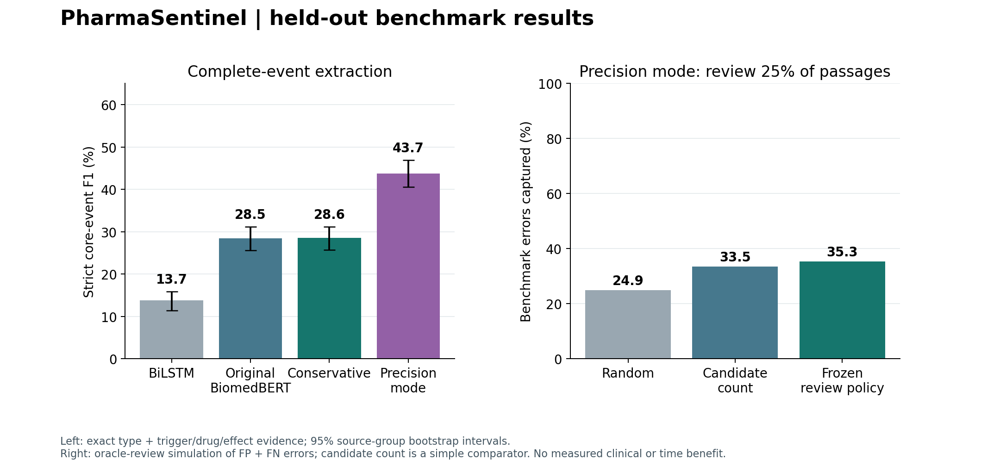
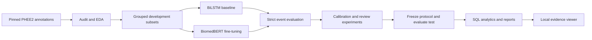

# PharmaSentinel

**Implementation:** local training, inference, calibration, review analysis, a Streamlit viewer,
and MySQL exports. See the [full runbook](docs/RUNBOOK.md),
[final results](docs/RESULTS.md), and [experiment decisions](docs/EXPERIMENT_PLAN_V2.md).
The earlier [retry audit](docs/RETRY_PLAN.md) is retained as a historical record.

**Evidence-grounded biomedical event extraction and reliability analytics.**

PharmaSentinel extracts suspected drug-related events from short biomedical passages,
keeps exact supporting text, and evaluates how limited human-review effort can be allocated.
The emphasis is data preparation, NLP, deep learning, statistical evaluation and SQL analytics.

This is a student research prototype, not clinical decision support or a regulatory reporting system.
An extracted association does not establish that a medicine caused an effect.

## Held-out results

On **967 eligible test passages**, with model/calibrator/review choices frozen before evaluation:

| Model | Strict core-event F1 |
|---|---:|
| BiLSTM baseline | 13.7% |
| Original BiomedBERT | 28.5% |
| Conservative mode | 28.6% |
| Precision-oriented mode | **43.7%** |

Precision mode improved F1 by **15.2 percentage points** over the original transformer
(paired source-group bootstrap 95% interval: **12.6 to 17.7 points**). Its frozen
raw-confidence review policy exposed **35.3% of FP + FN errors at a 25% passage budget**,
versus **24.9%** for random review. This is a simulated benchmark result, not measured time savings.
Candidate Brier score improved from **0.295 to 0.195** after calibration; the calibration-prevalence
constant comparator scored 0.247. Calibration does not account for missed events.

Therapeutic-event recall remains only **18.3%** in precision mode. Development results
showed a minority-recall tradeoff; the test result recovered 22/120 therapeutic events
versus 20/120 for the original model. The development safeguard was never relaxed.
These results support an applied research project, not autonomous medical use.
On the small synthetic test, precision mode scored only 11.8% strict F1 and produced
spurious events on 3 of 4 no-event passages. Its benchmark improvement does not
establish generalization to arbitrary biomedical text.



See [complete results and uncertainty](docs/RESULTS.md) for class breakdowns, review
comparators and synthetic failure probes. Two training seeds produced 42.7% and 41.8%
development F1; these are kept separate from the final test score.

## Problem and objective

A medicine can cause an effect, treat an effect, or appear beside an unrelated effect.
Recognizing names alone cannot distinguish these cases. Our objective is to extract typed
events with source evidence, quantify extraction errors, and compare review strategies at
the same passage budget.

## Pipeline



## Data

- **PHEE2 source annotations:** 4,827 passages in the pinned upstream files. Supplied
  train/dev/test counts are 2,898 / 961 / 968. Generated augmentation is not used.
- **Development allocation:** 487 model-selection, 222 calibration and 252 policy-selection
  passages, grouped using source-ID prefixes.
- **Synthetic diagnostic suite:** 10 development and 10 reserved examples containing
  therapeutic events, negation, multiple events, discontinuous evidence and no-event text.
  These are fictional language checks, not expert medical labels.

One upstream evidence annotation is invalid. Its passage is explicitly quarantined from
training/scoring and retained in the local data/audit trail. The original text is never silently
rewritten. See [data card](docs/DATA_CARD.md) and generated manifests in `reports/data/`.

## Models and contribution

**Baseline:** independent BiLSTM trigger/type, drug and effect heads, with nearest-trigger
association. **Main model:** a shared BiomedBERT encoder with typed trigger detection and
trigger-conditioned drug/effect heads. All outputs use the same declared reduced schema.

The applied contribution is **evidence-backed extraction reliability analysis**:
candidate confidence calibration, source highlighting, subgroup error analysis and
passage-review comparisons. Review policies include random order, raw confidence,
calibrated confidence, structural checks and an additive expected-incorrect-candidate score.
We do not claim these underlying methods are new research inventions.

Two release modes make the precision/recall tradeoff explicit:

- `pharmasentinel_final`: **conservative mode**, retaining the original biomedical
  weights and a 0.5 trigger threshold that preserved therapeutic detections on development data.
- `biomedbert_all_ce`: **precision-oriented mode**, using ordinary cross-entropy for
  all heads. It achieved higher development F1 but failed the conservative therapeutic-recall
  safeguard. It is evaluated separately; its threshold remains zero.

The safeguard is a development selection rule, not a promise of recall on unseen data.
The release also compares the original transformer and BiLSTM baseline. Four loss variants
and a second training seed are documented, including experiments that did not meet the safeguard.

## Setup

Python 3.11+ is required. Python 3.13 was used for the initial local runs. Use a clean
environment and install a PyTorch build appropriate to your hardware before fine-tuning.

```powershell
python -m venv .venv
.\.venv\Scripts\Activate.ps1
python -m pip install -c constraints-tested.txt -e ".[dev,viewer,mysql,figures]"
```

The core pipeline reads/writes files and does not require a MySQL server. MySQL is an optional
analytical sink; source text, local exports and weights are excluded from Git.

## Run the reproducible pipeline

Run commands from the repository root.

```powershell
python -m pharmasentinel fetch
python -m pharmasentinel prepare
python -m pharmasentinel audit
python -m pharmasentinel leakage-screen
python -m pytest -q -p no:cacheprovider

python -m pharmasentinel train --model baseline --name baseline

# Use only after verifying a working CUDA device. The CPU configuration is separate.
python -m pharmasentinel train --model biomedbert --name biomedbert --config configs/biomedbert_gpu.json

python scripts/development_results.py --names baseline biomedbert
```

The dataset fetch verifies Git blob hashes against an immutable revision. The encoder fetch
verifies upstream file identities, including the weight-file SHA-256, and uses a flat local
directory to avoid Windows cache symlink/long-path issues. No remote custom model code is executed.

Training saves selected weights, tokenizer/vocabulary, configuration, history, environment,
alignment diagnostics and data hashes. `--limit 32` is a smoke run only; never describe it as
full-data training. Choose a distinct run name for smoke experiments.

### Freeze and final evaluation

After completing all development commands in [RUNBOOK.md](docs/RUNBOOK.md):

```powershell
python -m pharmasentinel freeze --names baseline biomedbert pharmasentinel_final biomedbert_all_ce
python scripts/final_evaluation.py --names baseline biomedbert pharmasentinel_final biomedbert_all_ce
```

Test prediction/evaluation requires `--final-test` and a frozen protocol. The artifact, code
and data hashes are checked. Do not change model or policy choices after inspecting test scores
and continue calling the same test set unseen. Reports label development and final test results
separately. The committed frozen protocol documents this release. For a new replication,
archive its copy before creating your own freeze; do not overwrite the published evidence
or expect newly trained floating-point weights to reproduce its exact artifact hashes.
See [evaluation protocol](docs/EVALUATION_PROTOCOL.md).

### Local viewer

```powershell
python -m streamlit run ui/app.py --server.address 127.0.0.1 --browser.gatherUsageStats false
```

The viewer presents EDA, model quality, review curves and an evidence-backed passage demo.
It directly calls local Python functions; there is no separate API server or multiuser workflow.

### MySQL analytics

```powershell
python -m pharmasentinel mysql-export --name biomedbert --split policy

# Configure PHARMASENTINEL_MYSQL_* in your environment; see .env.example.
python -m pharmasentinel mysql-load --name biomedbert --split policy
```

The loader creates three tables in a dedicated configured database and uses parameterized
inserts. It does not drop tables or delete existing databases. Schema and analytical queries
are in `sql/`. MySQL loading is not verified until a reachable server and credentials are supplied.

## Evaluation

- Strict core-event precision/recall/F1: correct type and exact trigger/drug/effect span sets.
- Relaxed role-overlap event scores, reported separately.
- Standalone evidence scores and adverse/therapeutic class breakdowns.
- Unmatched gold events, complete trigger misses and subgroup failures.
- Source-group bootstrap intervals and, when both runs exist, paired comparison.
- Candidate reliability/Brier scores on data not used to fit the calibrator.
- Error capture at 10%, 25% and 50% passage-review budgets.

Duplicate predictions cannot earn repeated credit. Completely missed events remain in the
denominator. The metric covers a reduced event-role schema and is not directly comparable
with published scores for all PHEE fields. Oracle-review simulations do not establish actual
reviewer time savings. All measured results belong in generated reports, not projected claims.

## Repository

```text
configs/                    pinned data and model settings
src/pharmasentinel/          preparation, models, evaluation, analytics and CLI
data/challenge/             original synthetic diagnostic examples
docs/                       task, data, evaluation and interview explanations
scripts/                    sequential reproducible experiment runners
sql/                        three-table schema and analytical queries
ui/                         optional local Streamlit viewer
tests/                      scientific and inference correctness checks
reports/                    aggregate manifests, metrics and charts
data/raw/, data/processed/   local only, ignored
artifacts/                  local weights and fitted components, ignored
```

## Limitations and attribution

PHEE is event-enriched and sentence-oriented. A no-output prediction does not establish absence
of an event. Source grouping is based on ID prefixes; a lexical duplicate screen cannot rule out
all semantic leakage. Discontinuous evidence is preserved, but fine-grained entity grouping and
overlapping same-role spans remain decoder limitations. Corpus counts are not population incidence.

See [attribution](ATTRIBUTION.md), [project report](docs/PROJECT_REPORT.md), and
[interview guide](docs/INTERVIEW_GUIDE.md). Original code is MIT-licensed; datasets,
pretrained weights and publications retain their own rights.

